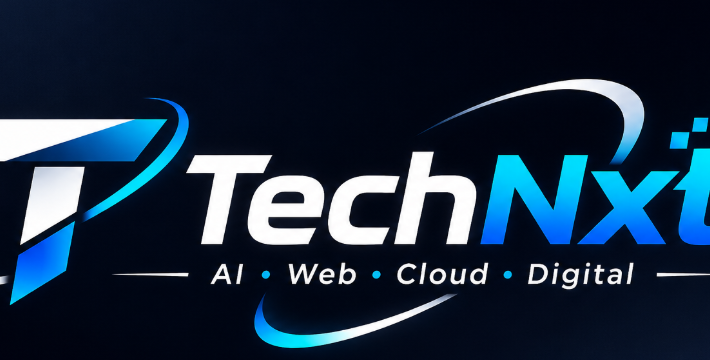

# TechNxtAi — Autonomous AI & Enterprise Architecture Platform



> **Transform Your Vision Into Scalable Software Powered By Modern AI.**  
> *AI Agent Orchestration • Bespoke Web Engineering • AWS Cloud Architecture • Digital Growth*

---

## ⚡ Executive Overview

**TechNxtAi** ([https://technxtai.com](https://technxtai.com)) is a premier technology-driven firm delivering next-generation digital solutions for global enterprises, fast-growing startups, and mission-driven institutions.

This repository hosts the official, production-ready, single-file enterprise platform built with an **ultra-luxurious Cyber-Obsidian aesthetic**, an interactive **3D WebGL Quantum Core**, and strict compliance with the **Digital Personal Data Protection Act (DPDP Act, 2023 & Rules 2026)**.

- 📍 **Registered Headquarters:** 505, Mahabir Tower, Main Road, Ranchi, Jharkhand – 834001, India
- 📞 **Direct Contact:** [+91 9801506511](tel:+919801506511)
- ✉️ **Official Email:** [india.futurenxt@gmail.com](mailto:india.futurenxt@gmail.com)
- 🤝 **Powered By:** **Agents Of Change** & **FutureNXT**
- 🛡️ **Enterprise SLA:** 99.9% Cloud Availability Guarantee

---

## 🎨 Strict 100% Zero-Blue Design Language

The visual system enforces an uncompromised **Zero-Blue Policy** (no blue, cyan, teal, indigo, or purple hues anywhere in CSS, SVG, or Three.js lighting):

| Color Spec | Hex Value | Functional Role |
| :--- | :--- | :--- |
| **Deep Obsidian Void** | `#020406` | Primary canvas & ultra-dark background layer |
| **Obsidian Velvet Surface** | `#05080C / #0E1420` | Glassmorphic smoked dark acrylic cards (20px backdrop blur) |
| **Cyber Emerald** | `#00FF87 / #05DF72` | Neon active nodes, orbital swooshes, primary CTAs & live telemetry |
| **Liquid Champagne Gold** | `#FFD166 / #F59E0B` | 3D metallic facets, orbital light trails, luxury partner badges |
| **Brushed Titanium** | `#E2C792 / #94A3B8` | Technical labels, metadata, and editorial typography |
| **Champagne Off-White** | `#F8FAFC` | High-contrast editorial headlines & lead body text |

**Typography Stack:** Google Fonts — `'Space Grotesk'` (geometric headings), `'Inter'` (editorial UI body), and `'JetBrains Mono'` (technical telemetry and system logs).

---

## 🌌 3D WebGL Quantum Core Engine (Three.js r128 + GSAP)

A fixed full-viewport hardware-accelerated 3D background canvas running at 60 FPS:
1. **Outer Geodesic Wireframe:** High-frequency `IcosahedronGeometry` glowing in Cyber Emerald (`#00FF87`) with additive blending.
2. **Inner Faceted Core:** Flat-shaded `DodecahedronGeometry` with high metalness (0.85) and low roughness (0.15) in Champagne Gold (`#FFD166`).
3. **Triple Gyroscopic Rings:** 3 concentric Torus meshes rotating across X, Y, and Z axes, dynamically mimicking the TechNxtAi orbital swoosh.
4. **Vortex Particle Field:** 1,000+ interactive dual-tinted dust particles smoothly reacting to cursor delta and scroll depth.

---

## 🌐 Featured Live Client Deployments

TechNxtAi showcases verified production platforms engineered, deployed, and supported for global clients:

| Client Project | Domain / Live URL | Industry / Category | Key Technical Architecture |
| :--- | :--- | :--- | :--- |
| **Infinty Learning** | [infintylearning.net](https://infintylearning.net/) | EdTech & Digital LMS | Interactive LMS, Video Streaming, Student Performance Analytics, Cloudflare CDN |
| **Prithviwasi** | [prithviwasi.org](https://prithviwasi.org/) | Sustainability & NGO | Impact Donation Gateway, Tree-Plantation Tracker, CSR Volunteer Portal |
| **FitIndia4U** | [fitindia4u.com](https://fitindia4u.com/) | Health & Fitness | Workout Tracking, Diet & Nutrition Schedules, Personal Trainer Booking Portal |

---

## 🛡️ DPDP Act 2026 Statutory Compliance Suite

Strictly aligned with India's **Digital Personal Data Protection Act, 2023 & DPDP Rules 2026**:

- **Statutory Notice (Section 5):** Clear, itemised notice of personal data collected (Name, Phone, Email, Scoping details) and specified lawful purpose.
- **Explicit Consent Mechanism (Section 6):** Unchecked, affirmative consent checkboxes on the Project Inquiry Form and Strategy Call Booking modal.
- **Floating Consent Banner & Cookie Preference Center:** Allows users to toggle Strictly Necessary, Communications, and Performance Telemetry.
- **Data Principal Rights Portal (Sections 11–14):** Interactive self-service portal empowering citizens to claim:
  - *Right to Access Information (Sec 11)*
  - *Right to Correction & Updating (Sec 12)*
  - *Right to Erasure / Deletion ("Right to be Forgotten", Sec 12)*
  - *Right to Withdraw Consent (Sec 6(4))*
  - *Right of Grievance Redressal (Sec 13)*
  - *Right to Nominate (Sec 14)*
  - Automated Statutory Ticket ID generation with **72-hour resolution SLA**.
- **Designated Grievance Redressal Officer (Section 8(9) & 13):**
  - **Officer:** Data Protection & Grievance Officer
  - **Email:** `india.futurenxt@gmail.com` | **Phone:** `+91 9801506511`
  - **Address:** 505, Mahabir Tower, Main Road, Ranchi, Jharkhand – 834001, India
  - **Appellate Right:** Notice of right to appeal to the Data Protection Board of India (DPBI).
- **Children's Data Protection (Section 9):** Zero tracking, profiling, or targeted marketing directed at minors under 18 years.
- **Security Safeguards (Section 8(5)):** AES-256 encryption at rest, TLS 1.3 in transit.

---

## 🏛️ Comprehensive Corporate Policies & Modals

The website integrates 5 corporate governance pillars directly accessible via the column-wise footer:

1. **Terms & Conditions:** Governs service scoping, GST-compliant milestone billing, 99.9% cloud uptime SLA, mutual NDA, and complete **100% intellectual property & source code transfer** to the client upon full payment. Exclusive jurisdiction: Courts at Ranchi, Jharkhand, India.
2. **Refund & Cancellation Policy:** 48-hour 100% advance refund prior to sprint start; milestone-based prorated refunds; 15-day written notice for monthly maintenance retainers; 5–7 banking days refund turnaround.
3. **About Us:** Corporate profile, Ranchi registered headquarters, core values, and founding leadership.
4. **Contact & Technical Support Helpdesk:** Multi-channel 24/7 assistance (+91 9801506511, email, instant WhatsApp desk) with a documented P1 (under 60 min), P2 (under 4h), and P3 incident SLA matrix.
5. **Cookies Settings:** Granular consent preferences with one-click revocation.

---

## 📂 Project Directory Structure

```text
technxt-website/
│
├── .gitignore                          # Git exclusion rules
├── .htaccess                           # Clean URL routing & Apache caching headers
├── favicon.ico                         # Root multi-size icon (16, 32, 48, 64px) for Googlebot
├── index.html                          # Homepage & hero overview
├── about.html                          # Company mission & leadership
├── services.html                       # 6 core enterprise service domains
├── sectors.html                        # 6 industry sector transformations
├── process.html                        # 4-stage delivery lifecycle
├── blueprints.html                     # Enterprise architecture & tech stack
├── why-us.html                         # 8 key differentiators & SLAs
├── projects.html                       # Featured live client projects
├── contact.html                        # Inquiry desk & multi-channel helpdesk
├── faq.html                            # Enterprise technical FAQ
├── privacy.html                        # DPDP Act 2026 privacy policy
├── terms.html                          # Terms of service
├── refund.html                         # Service SLA & refund terms
├── README.md                           # Enterprise documentation (this file)
│
└── assets/
    ├── css/
    │   └── style.css                   # Custom styles, glassmorphism, zero-blue rules & animations
    │
    ├── js/
    │   └── main.js                     # Client logic: modals, service filters, Three.js 3D core & interactive widgets
    │
    └── images/
        ├── apple-touch-icon.png        # 180x180 iOS home-screen icon
        ├── favicon.png                 # 512x512 high-DPI PWA & Google Search snippet icon
        ├── favicon-32x32.png           # 32x32 browser tab icon
        ├── logo_agents_of_change.png   # Official circular logo: Agents Of Change
        ├── logo_futurenxt.png          # Official brand logo: FutureNXT
        ├── logo_3d.png                 # 3D brand asset
        └── technxt_logo_banner.png     # Official high-resolution brand banner
```

---

## 🚀 Local Development Setup

This project is built using standard, dependency-free web technologies (HTML5, Tailwind CSS via CDN, Three.js, Vanilla JavaScript). No Node.js build step is required.

### 1. Clone the repository:
```bash
git clone https://github.com/fnxtinterns-Main/technxt-website.git
cd technxt-website
```

### 2. Launch the local web server:
Using Python 3:
```bash
python -m http.server 3000
```
Or using Node `npx serve`:
```bash
npx serve -l 3000
```

### 3. Open in your browser:
Navigate to [http://localhost:3000](http://localhost:3000)

---

## 🔍 Google Search & SEO Configuration

- **Favicons for Googlebot:** Generated in exact compliance with Google's guidelines (multiples of 48px: `favicon.ico`, `favicon.png`).
- **Semantic Metadata:** Canonical URLs, OpenGraph social cards, Twitter meta tags, and structured schemas.
- **Fast Re-Indexing:** To update Google search results after deployment, visit [Google Search Console](https://search.google.com/search-console), inspect `https://technxtai.com/`, and click **"Request Indexing"**.

---

## 🤝 Partners & Corporate Governance

TechNxtAi is proudly powered by:
- **Agents Of Change** — Global initiative driving technological empowerment and digital transformation.
- **FutureNXT** — Next-generation technology ecosystem providing strategic guidance and innovation scaling.

---

## 📄 License & Intellectual Property

© 2026 **TechNxtAi**. All rights reserved.  
Registered in Ranchi, Jharkhand, India.  
All brand assets, custom 3D WebGL shaders, and codebases are proprietary property of TechNxtAi and its partner entities.
